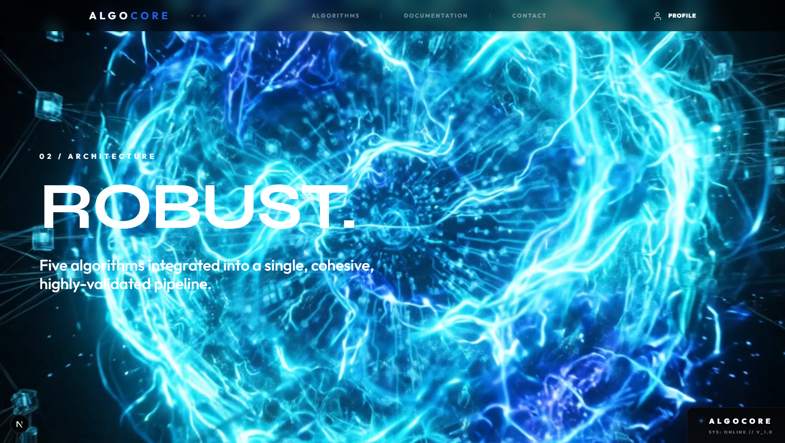
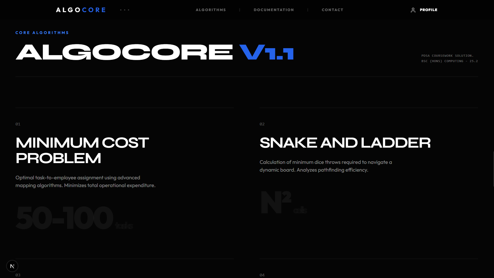
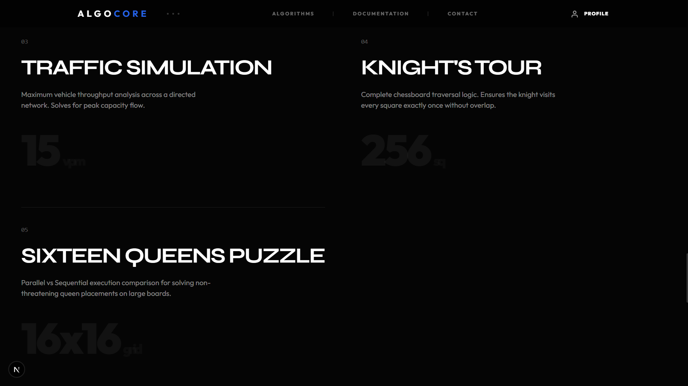
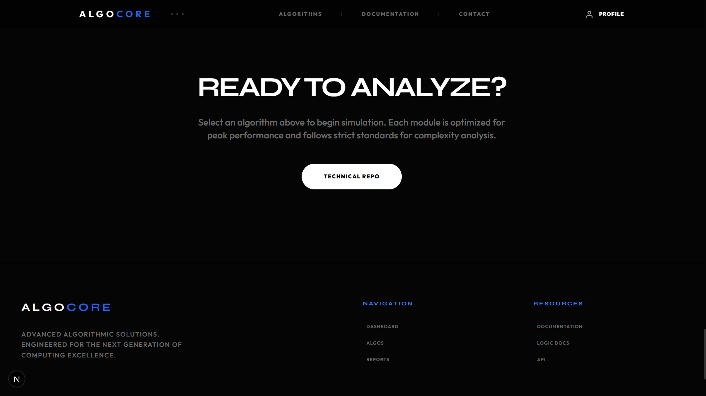
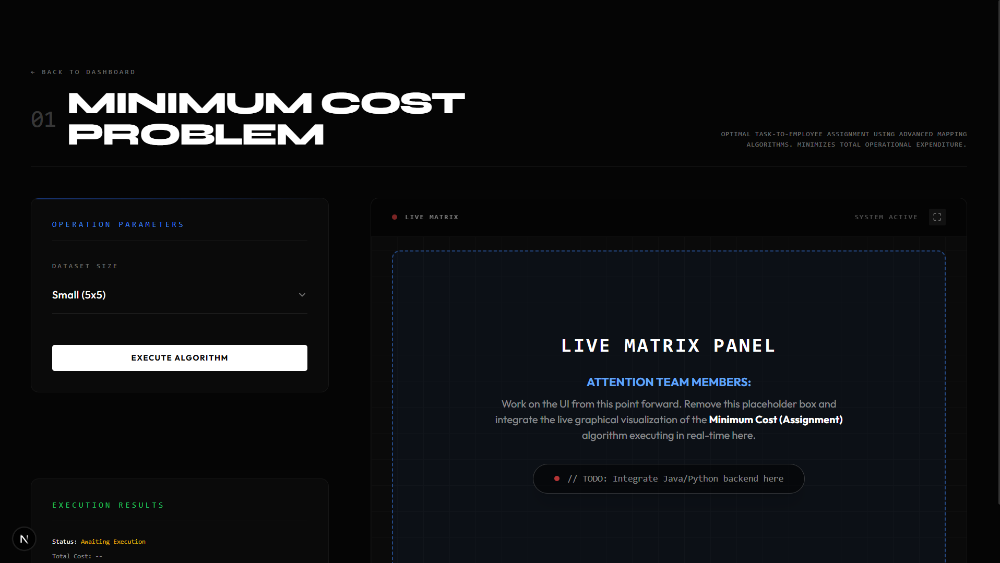

# ALGOCORE - Getting Started

This guide provides instructions on how to set up and run the ALGOCORE project locally.

## Prerequisites
- **Node.js** (v18 or higher)
- **Java** (JDK 17 or higher)
- **Maven**
- **MySQL Server**

---

## Frontend Interface Preview

Here is a visual walkthrough of the ALGOCORE frontend interface:

| | |
| :---: | :---: |
|  |  |
|  |  |

| |
| :---: |
|  |

---

## 1. Backend Setup (Java Spring Boot)

1. **Navigate to the backend directory:**
   ```powershell
   cd games-backend
   ```

2. **Database configuration:**
   Ensure you have a MySQL database created and update the `src/main/resources/application.properties` with your credentials if necessary.

3. **Install dependencies and run:**
   ```powershell
   mvn clean install
   mvn spring-boot:run
   ```

---

## 2. Frontend Setup (Next.js)

1. **Navigate to the frontend directory:**
   ```powershell
   cd frontend
   ```

2. **Install dependencies:**
   ```powershell
   npm install
   ```

3. **Start the development server:**
   ```powershell
   npm run dev
   ```

4. **Access the application:**
   Open [http://localhost:3000](http://localhost:3000) in your browser.

## Final Push Instructions
When committing changes, ensure your git attribution is correct:
```powershell
git config user.email "chanirub2003@gmail.com"
git config user.name "Chaniru Weerasinghe"
```
